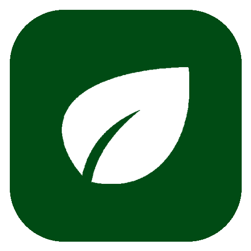
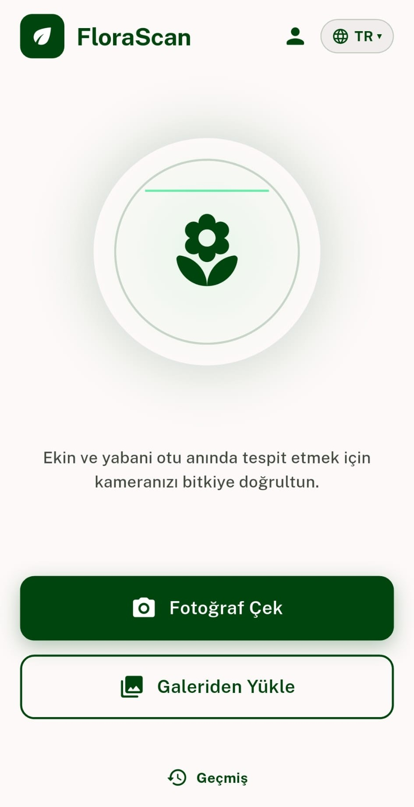
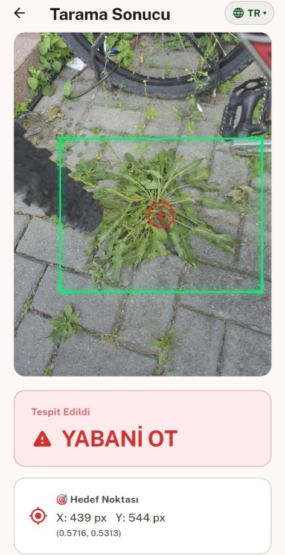
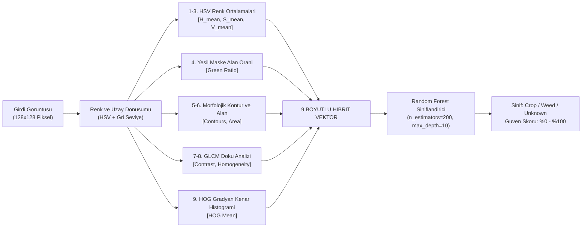
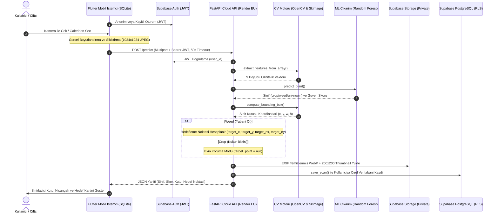

# FloraScan

### Bilgisayarlı Görü Tabanlı Hassas Tarım ve Robotik Hedefleme Sistemi

Ekin ve yabani otları morfolojik özniteliklerle anlık olarak tespit eden, pülverizatör ve otonom ilaçlama nozulları için milimetrik hedef koordinatı üreten tarımsal bilgisayarlı görü sistemi.

  
  
  
  
  

---

> **Gizlilik ve Fikri Mülkiyet Bildirimi (Intellectual Property Notice):**  
> Bu proje; **TÜBİTAK 2209-A Üniversite Öğrencileri Araştırma Projeleri Destekleme Programı** ve **Mühendislik Lisans Bitirme Tezi** kapsamında geliştirilmektedir. Akademik yayın, patent ve tez teslim süreçlerinin korunması amacıyla sistemin çekirdek kaynak kodları bu vitrin deposunda açık kaynak olarak sunulmamaktadır. Bu repository; projenin sistem mimarisini, öznitelik mühendisliği yöntemlerini, model başarım metriklerini ve arayüzünü sergileyen resmi vitrin deposudur.

---

## Projeye Genel Bakış

Geleneksel tarımsal mücadelede yabani otlar tüm tarlaya homojen ve aşırı miktarda kimyasal herbisit (tarım ilacı) püskürtülerek yok edilmeye çalışılmaktadır. Bu durum; toprak kirliliğine, yeraltı sularının zehirlenmesine, kültür bitkilerinin stres altına girmesine ve yüksek kimyasal girdi maliyetlerine yol açmaktadır.

FloraScan, mobil kamera aracılığıyla tarladaki bitki örtüsünü anlık olarak analiz eder:

1. **Sınıflandırma:** Bitkinin Kültür Bitkisi (Crop) mi yoksa Yabani Ot (Weed) mu olduğunu %96.91 doğrulukla sınıflandırır.
2. **Morfolojik Segmentasyon:** Hedef bitki gövdesini çevreleyen dinamik sınırlayıcı kutuyu (Bounding Box) hesaplar.
3. **Hassas Hedefleme:** Tespit edilen bitki yabani ot ise, bitkinin geometrik ağırlık merkezini çıkararak ilaçlama nozullarının kilitlenebileceği piksel ve normalize koordinatları ($X, Y, nX, nY$) üretir.
4. **Ekin Koruma Modu:** Tespit edilen bitki bir kültür bitkisi ise, ilaçlama mekanizması bloke edilir (`target_point = null`) ve ekin koruma kalkanı devreye girer.

---

## Mobil Kullanıcı Arayüzü ve Hedefleme Akışı

Saha koşulları ve doğrudan güneş ışığı altında optimum okunabilirlik sağlamak amacıyla yüksek kontrastlı arayüz hiyerarşisi uygulanmıştır:

  <table>
    <tr>
      <th align="center" width="50%">Ana Ekran ve Kamera/Galeri Seçimi</th>
      <th align="center" width="50%">Analiz Sonucu, Sınırlayıcı Kutu ve Hedef Koordinatı</th>
    </tr>
    <tr>
      <td align="center">
        
      </td>
      <td align="center">
        
      </td>
    </tr>
    <tr>
      <td align="center"><em>Çekim, galeri seçimi, çift dilli (TR/EN) arayüz ve hesap/geçmiş erişimi</em></td>
      <td align="center"><em>Yeşil sınırlayıcı kutu, kırmızı nişangah ve milimetrik koordinat kartı</em></td>
    </tr>
  </table>

* **Görüntü Optimizasyonu ve Gizlilik:** Çekilen yüksek çözünürlüklü ham fotoğraflar (10+ MB), istemci tarafında $1024 \times 1024$ JPEG %85 (~300 KB) formatına sıkıştırılır; sunucu tarafında EXIF konum/cihaz metaverileri temizlenerek WebP (~120-150 KB) ve 200x200 küçük resme (`thumb.webp`) dönüştürülür.
* **Görsel Geri Bildirim:** Analiz edilen yabani ot üzerinde yeşil sınırlayıcı kutu ve kırmızı hedef artı işareti (crosshair) dinamik olarak çizilir.
* **Telemetri ve Koordinat Kartı:** Piksel ($X: 439\text{ px}, Y: 544\text{ px}$) ve normalize koordinatlar ($0.5716, 0.5313$) ekranda kullanıcıya ve donanım arayüzüne sunulur.
* **Çift Dilli Arayüz ve Esnek Ekran Uyumu:** Türkçe öncelikli anlık **TR/EN** dil değişimi (`flutter_localizations`), izin reddi/kimlik doğrulama hatalarının yerelleştirilmiş yönetimi ve farklı ekran oranlarına uyumlu taşmasız düzen sunulur.
* **Kayıt Gerektirmeyen Kullanım ve Çevrimdışı Geçmiş:** İlk açılışta arka planda anonim oturum başlatılır; kullanıcı dilediğinde e-posta ile kalıcı hesaba geçip misafir taramalarını birleştirebilir veya geçmiş taramalarını internet kesintilerinde dahi yerel SQLite önbelleğinden görüntüleyebilir.

---

## Bilimsel ve Mühendislik Yaklaşımı

### 9 Boyutlu Hibrit Öznitelik Vektörü

Yüksek bellek tüketimine ve mobil cihazlarda aşırı ısınmaya yol açan derin öğrenme mimarileri yerine, yaprak morfolojisini ve dokusunu doğrudan modelleyen 9 boyutlu hibrit bir matematiksel öznitelik vektörü geliştirilmiştir:

$$\vec{V} = [H_{mean}, S_{mean}, V_{mean}, Green_{ratio}, Contours, Area, Contrast_{GLCM}, Homogeneity_{GLCM}, HOG_{mean}]$$

### Model Karşılaştırma ve Başarım Tablosu

| Algoritma | Parametreler | Test Doğruluğu | Çıkarım Karakteristiği |
| :--- | :--- | :--- | :--- |
| **Random Forest (Seçilen)** | `n_estimators=200, max_depth=10` | **%96.91** | **En yüksek genelleme, mikrosaniyeler mertebesinde çıkarım süresi, aşırı öğrenmeye karşı direnç.** |
| **Gradient Boosting (GBDT)** | `n_estimators=150, lr=0.1, max_depth=3` | %94.98 | Yüksek doğruluk; sıralı ağaç yapısı nedeniyle daha uzun çıkarım süresi. |
| **Lojistik Regresyon** | `max_iter=1000` | %88.42 | Doğrusal sınır; karmaşık yaprak dokusu ve ışık değişimlerinde sınırlı başarım. |
| **Destek Vektör Makineleri (SVM)** | `RBF Kernel, C=10, gamma='scale'` | %86.49 | Doğrusal olmayan karar sınırı; ölçeklenmemiş öznitelik uzayında daha düşük ayrım. |

* **5-Katlı Çapraz Doğrulama (5-Fold Cross Validation):** %96.64 kararlı doğruluk (OOB tahmini: %97.21, Eğitim seti: %99.81).
* **Model Dosya Boyutu:** Yalnızca 1.7 MB (`flora_model.joblib`), bulut ve uç cihazlarda anlık bellek yükleme imkanı.

---

## Uçtan Uca Sistem Mimarisi

Sistem; mobil istemci, kimlik doğrulama katmanı, bulut API, görüntü işleme motoru, makine öğrenmesi çıkarım birimi, gizli nesne depolama ve ilişkisel veritabanından oluşan dağıtık bir yapı üzerinde çalışır:

---

## Teknoloji Yığını

| Katman | Teknoloji / Kütüphane | Görev ve Sorumluluk |
| :--- | :--- | :--- |
| **Mobil Uygulama** | Flutter 3.x, Dart | Çapraz platform istemci, responsive arayüz, TR/EN `l10n` desteği |
| **Durum Yönetimi** | Provider | Durum yönetimi ve asenkron veri akışı |
| **Yerel Önbellek** | `sqflite`, `cached_network_image` | Çevrimdışı tarama geçmişi ve küçük resim önbellekleme |
| **Görüntü İşleme (İstemci)** | `flutter_image_compress` | Kamera çekimlerini ağ transferi öncesi optimize etme |
| **Kimlik Doğrulama** | Supabase Auth (`supabase_flutter`, `PyJWT`) | Anonim misafir oturumu, hesap yükseltme/birleştirme ve JWT doğrulama |
| **Backend Framework** | FastAPI (Python 3.11+) | Asenkron RESTful API mimarisi, EXIF temizliği, KVKK uyumlu hesap silme |
| **Bulut Dağıtımı** | Render PaaS (Frankfurt EU) | Konteynerize üretim sunucusu ve 50 sn soğuk başlatma toleransı |
| **Sağlık İzleme** | UptimeRobot | 5 dakikalık periyotlarla HTTP HEAD denetimi (Soğuk Başlatma Önleme) |
| **Görsel Depolama** | Supabase Storage (Private Bucket) | WebP tam görsel/thumbnail saklama ve 1 saatlik `signed URL` üretimi |
| **Veritabanı** | Supabase (PostgreSQL 15) | Kullanıcıya izole tarama telemetrisi, Supavisor IPv4 Pooler, RLS güvenliği |
| **Bilgisayarlı Görü** | `opencv-python-headless`, `scikit-image` | Renk dönüşümleri, morfolojik filtreleme, GLCM, HOG analizi |
| **Makine Öğrenmesi** | `scikit-learn`, `joblib`, `numpy` | Random Forest sınıflandırma ve tensör işlemleri |

---

## Proje ve İletişim

**Ali Alperen Civil**  
Lisans Bitirme Projesi & TÜBİTAK 2209-A Araştırmacısı  

* **GitHub Profili:** [github.com/AliAlperenCivil](https://github.com/AliAlperenCivil)  
* **Canlı API Durumu:** Aktif (Production Deployed)  

---

  FloraScan Arastirma ve Gelistirme Projesi. Tum haklari saklidir.

