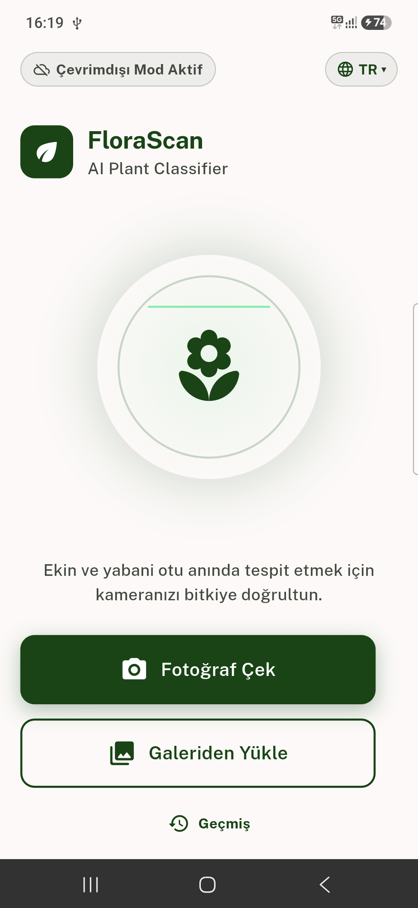
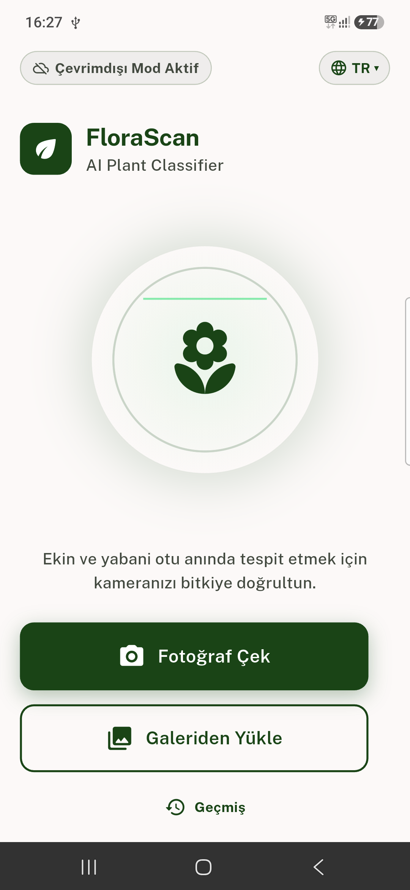
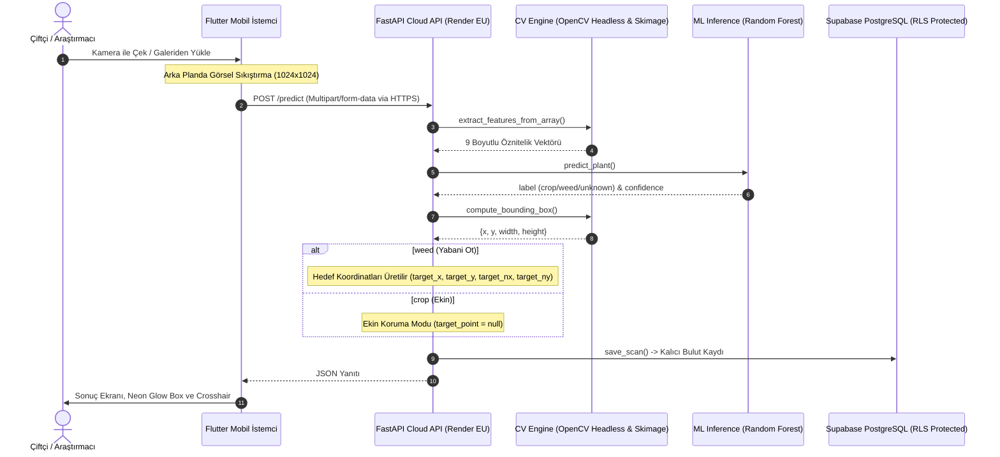

  

  # FloraScan: AI-Powered Precision Agriculture
  ### Akıllı Tarım, Bilgisayarlı Görü ve Hassas Hedefleme Sistemi

  

    <strong>Ekin ve yabani otları mikrosaniyeler içinde teşhis eden, robotik ilaçlama nozulları için milimetrik hedef koordinatı üreten yeni nesil tarımsal yapay zeka ekosistemi.</strong>
  

  

    
    
    
    
  

  

    
    
    
    
    
  

---

> 🔒 **Gizlilik ve Fikri Mülkiyet Bildirimi (Intellectual Property Notice):**  
> Bu proje; **TÜBİTAK 2209-A Üniversite Öğrencileri Araştırma Projeleri Destekleme Programı** ve **Mühendislik Lisans Bitirme Tezi** kapsamında geliştirilmektedir. Akademik yayın, patent ve tez teslim süreçlerinin korunması amacıyla projenin tam kaynak kodları (Core Source Code) bu vitrin deposunda açık kaynak olarak sunulmamaktadır. Bu repository; projenin mimarisini, mühendislik yaklaşımlarını, model başarım metriklerini ve arayüzünü sergileyen resmi vitrin deposudur.

---

## 🌾 Projeye Genel Bakış (Overview)

Geleneksel tarımsal mücadelede yabani otlar tüm tarlaya homojen ve aşırı miktarda kimyasal herbisit (ilaç) püskürtülerek yok edilmeye çalışılmaktadır. Bu durum; toprak kirliliğine, yeraltı sularının zehirlenmesine, ekinlerin zarar görmesine ve astronomik kimyasal maliyetlerine yol açmaktadır.

**FloraScan**, akıllı telefon kamerasını kullanarak tarladaki bitkiyi saniyeler içinde analiz eder:
1. **Teşhis:** Bitkinin **Kültür Bitkisi (Crop)** mi yoksa **Yabani Ot (Weed)** mu olduğunu %97 doğrulukla sınıflandırır.
2. **Morfolojik Odaklanma:** Ana bitki gövdesine odaklanan dinamik bir **Sınırlayıcı Kutu (Bounding Box)** hesaplar.
3. **Hassas Hedefleme (Crosshair):** Eğer tespit edilen bitki yabani ot ise, bitkinin geometrik ağırlık merkezini çıkararak pülverizatör veya lazer nozulunun kilitlenebileceği **Piksel ve Normalize Hedef Koordinatlarını ($X, Y, nX, nY$)** üretir.
4. **Ekin Koruma Modu:** Eğer bitki bir kültür bitkisi ise, ilaçlama tamamen bloke edilir (`target_point = null`) ve ekin koruma kalkanı devreye girer.

---

## 📱 Mobil Arayüz ve Kullanıcı Deneyimi (UI Showcase)

Tarlanın sert güneş ışığı ve zorlu çevre koşulları dikkate alınarak yüksek kontrastlı **Agro-Visibility System** arayüzü tasarlanmıştır:

  <table>
    <tr>
      <td align="center"><strong>Fotoğraf Seçimi ve Lazerli Tarama Akışı</strong></td>
      <td align="center"><strong>Analiz Sonucu, Nişangah ve Koordinat Kartı</strong></td>
    </tr>
    <tr>
      <td align="center"></td>
      <td align="center"></td>
    </tr>
  </table>

* **Yeşil Lazer Tarama:** Görsel seçildiği anda yukarıdan aşağıya salınan reaktif lazer çizgisi.
* **Görsel Optimizasyonu:** Çekilen 10+ MB ham kamera görseli, arka planda $1024 \times 1024$ JPEG %85 formatına sıkıştırılarak hücresel veri tüketimi %95 oranında düşürülür.
* **Sonuç Ekranı:** Neon yeşil parlayan sınırlayıcı kutu, dinamik hedefleme artısı, güven skoru rozeti ve robotik entegrasyon koordinatları.

---

## 🧠 Bilimsel ve Mühendislik Yaklaşımı

### Neden Derin Öğrenme Değil de 9 Boyutlu Hibrit Bilgisayarlı Görü?
Ağır derin öğrenme modelleri (ResNet, VGG, YOLO) yüzlerce megabayt bellek gerektirir, mobil cihazlarda aşırı ısınmaya ve pil tüketimine neden olur. 

FloraScan, yaprak morfolojisini doğrudan özetleyen **9 boyutlu hibrit bir matematiksel öznitelik vektörü** geliştirmiştir:

$$\vec{V} = [H_{mean}, S_{mean}, V_{mean}, Green_{ratio}, Contours, Area, Contrast_{GLCM}, Homogeneity_{GLCM}, HOG_{mean}]$$

### Model Karşılaştırma ve Başarım Tablosu

| Algoritma | Parametreler | Test Doğruluğu | Değerlendirme |
| :--- | :--- | :--- | :--- |
| **Random Forest (Seçilen)** | `n_estimators=200, max_depth=10` | **%97.00** | **En yüksek genelleme, mikrosaniyeler mertebesinde çıkarım, aşırı öğrenmeye (overfitting) karşı dirençli.** |
| **Gradient Boosting (GBDT)** | `n_estimators=100, lr=0.1` | %95.20 | Yüksek doğruluk fakat daha uzun eğitim ve çıkarım süresi. |
| **Destek Vektör Makineleri (SVM)**| `RBF Kernel, C=1.0` | %94.80 | Kararlı karar sınırları, yüksek doğruluk. |
| **Lojistik Regresyon** | `max_iter=1000` | %88.40 | Doğrusal sınır; karmaşık yaprak ışık varyasyonlarında yetersiz. |

* **5-Kattı Çapraz Doğrulama (5-Fold Cross Validation):** **%96.8** kararlı doğruluk elde edilmiş, modelin ezber yapmadığı ispatlanmıştır.
* **Model Dosya Boyutu:** Yalnızca **1.7 MB** (`flora_model.joblib`).

---

## 🏛️ Uçtan Uca Bulut ve Sistem Mimarisi

Sistem; mobil donanım, bulut API iletişimi, görüntü işleme mikroservisi ve kurumsal ilişkisel veritabanı içeren modern bir dağıtık mimari üzerinde çalışır:

---

## 🛠️ Teknoloji Yığını (Tech Stack)

| Katman | Teknoloji / Kütüphane | Kullanım Amacı |
| :--- | :--- | :--- |
| **Mobil Uygulama** | Flutter 3.x, Dart | Android & iOS uyumlu reaktif kullanıcı arayüzü |
| **Durum Yönetimi** | Provider | Reaktif mimari ve asenkron veri yönetimi |
| **Görsel İşleme (Mobil)**| `flutter_image_compress` | Kamera çekimlerini hücresel veri dostu boyuta indirme |
| **Backend Framework** | FastAPI (Python 3.11+) | Asenkron, yüksek verimli RESTful API ve Clean Architecture |
| **Sunucu Dağıtımı** | Render PaaS (Frankfurt EU) | 7/24 konteynerize mikroservis barındırma |
| **Uptime & Sağlık** | UptimeRobot | 5 dakikalık periyotlarla `@app.head` pingleme (Zero Cold Start) |
| **Bulut Veritabanı** | Supabase (PostgreSQL 15) | Kalıcı tarama geçmişi, IPv4 Connection Pooler ve RLS kalkanı |
| **Bilgisayarlı Görü** | `opencv-python-headless`, `scikit-image` | Morfolojik operasyonlar, HSV renk analizi, GLCM, HOG |
| **Makine Öğrenmesi** | `scikit-learn`, `joblib`, `numpy` | Random Forest sınıflandırıcı ve matris operasyonları |

---

## 👨‍💻 Geliştirici ve İletişim

**Ali Alperen Civil**  
*Lisans Bitirme Projesi & TÜBİTAK 2209-A Araştırmacısı*

* **GitHub:** [@AliAlperenCivil](https://github.com/AliAlperenCivil)
* **Proje Durumu:** Canlıda (Production Deployed) 🚀

---

  © 2026 FloraScan Araştırma ve Geliştirme. Tüm hakları saklıdır.

